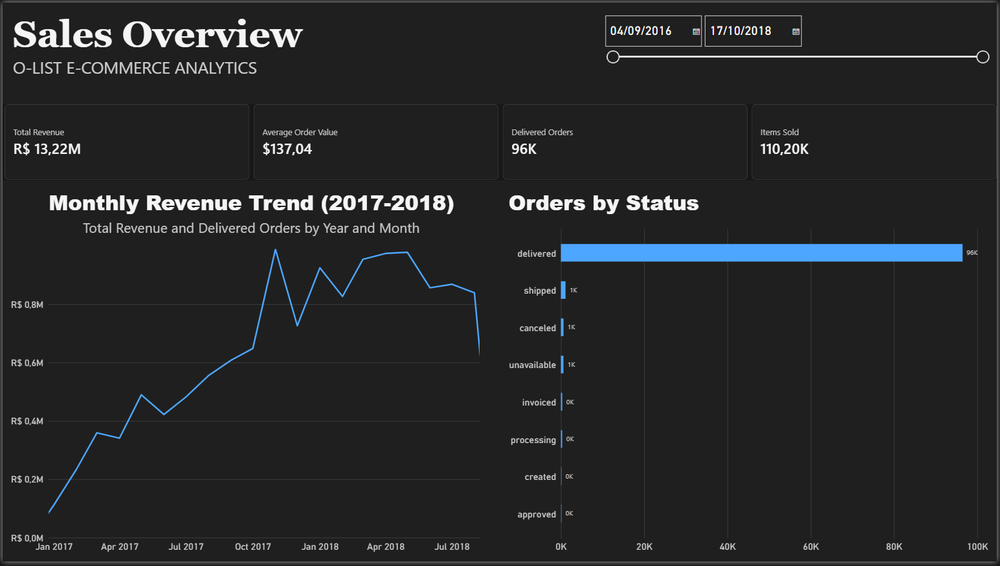
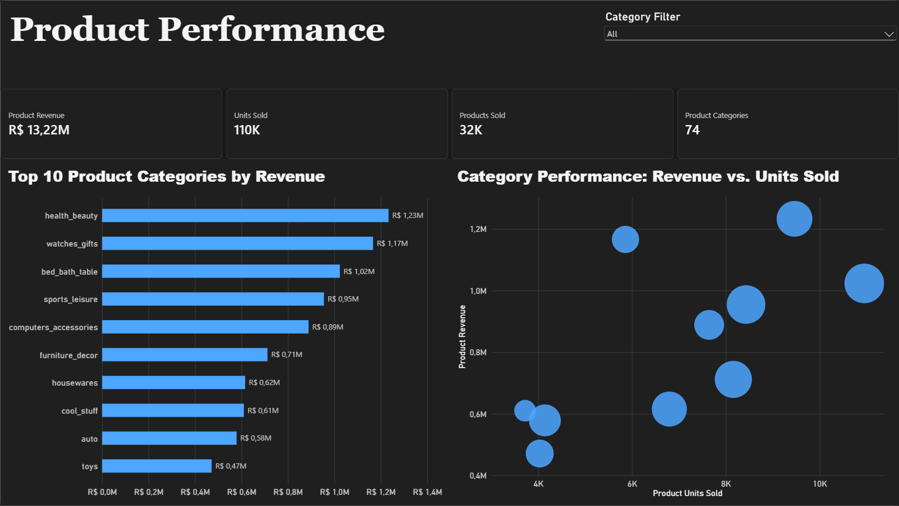
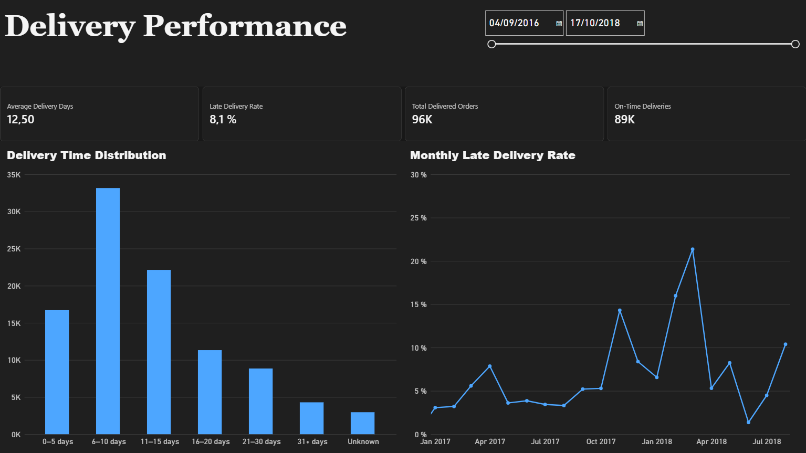
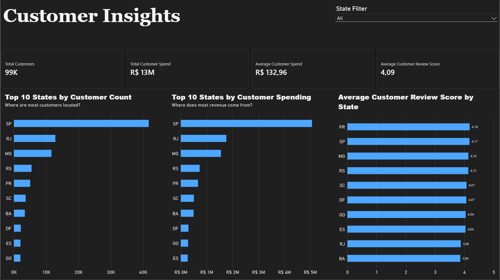

# E-Commerce Data Engineering & Analytics

An end-to-end data engineering and business intelligence project using the Brazilian Olist E-Commerce dataset. The project demonstrates how raw transactional data can be stored in the cloud, loaded into a data warehouse, transformed into analytics-ready models, validated through automated tests, and visualized in interactive dashboards.

**Tech Stack:** AWS S3 · AWS Glue · Snowflake · dbt · SQL · Power BI · Git

## Project Overview

This project implements a cloud-based analytics pipeline to explore e-commerce sales, product performance, delivery efficiency, and customer behavior.

The pipeline processes eight datasets covering orders, customers, products, sellers, payments, reviews, order items, and product category translations.

The main objectives are to:

- Build a cloud-based data ingestion and storage workflow.
- Organize raw data in Snowflake for analytical processing.
- Apply modular SQL transformations using dbt.
- Validate data quality with automated tests.
- Develop interactive Power BI dashboards for business insights.

AWS Glue is used for metadata discovery and cataloging. Snowflake loads data directly from S3 using an external stage and storage integration. dbt handles SQL-based transformations and data quality testing.

## Technologies Used

| Technology | Purpose |
|---|---|
| AWS S3 | Cloud storage for raw datasets |
| AWS Glue | Dataset discovery and metadata cataloging |
| Snowflake | Cloud data warehouse and SQL analytics |
| dbt Core | Data transformations, dependencies, and testing |
| SQL | Data cleaning, aggregation, and analytical modeling |
| Power BI | Interactive dashboards and DAX measures |
| Git & GitHub | Version control and project documentation |

## Dataset

**Source:** [Brazilian E-Commerce Public Dataset by Olist](https://www.kaggle.com/datasets/olistbr/brazilian-ecommerce)

The dataset contains approximately 100,000 orders placed on the Olist marketplace in Brazil between 2016 and 2018.

Eight source datasets are used in this project:

1. Customers
2. Orders
3. Order Items
4. Products
5. Payments
6. Reviews
7. Sellers
8. Product Category Translations

## Data Engineering Pipeline

### 1. Cloud Storage — AWS S3

Raw CSV files are uploaded to an Amazon S3 bucket, organized into separate folders by dataset.

The S3 bucket uses private access settings and server-side encryption.

### 2. Data Catalog — AWS Glue

AWS Glue crawlers discover the CSV structures and register eight tables in the Glue Data Catalog.

Custom CSV classifiers are used where necessary to correctly interpret source headers.

### 3. Data Warehouse — Snowflake

Snowflake connects to S3 using an AWS IAM role, storage integration, and external stage.

Raw data is loaded into the `ECOMMERCE_DB.RAW` schema using SQL `COPY INTO` operations.

The raw orders table contains **99,441 records**.

### 4. Data Transformation — dbt

The dbt project implements a layered transformation approach.

**Staging layer — 8 models**

- `stg_customers`
- `stg_orders`
- `stg_order_items`
- `stg_products`
- `stg_payments`
- `stg_reviews`
- `stg_sellers`
- `stg_category_translation`

These models standardize source data and prepare it for downstream analytics.

**Analytics layer — 4 models**

| Model | Purpose |
|---|---|
| `fct_sales` | Order-level sales and revenue metrics |
| `mart_products` | Product and category performance |
| `mart_delivery` | Delivery duration and late-delivery analysis |
| `mart_customers` | Customer-level order, spending, and review metrics |

The transformed tables are stored in the `DBT_STAGING` and `DBT_ANALYTICS` schemas.

## Data Quality and Validation

The project uses automated dbt tests, including:

- Unique identifier checks
- Non-null constraints
- Referential integrity checks
- Accepted-value checks

**Final dbt validation results:**

| Metric | Result |
|---|---:|
| dbt models | 12 |
| Automated data tests | 23 |
| Successful executions | 35 |
| Failed executions | 0 |

Additional SQL validation confirmed expected row counts, unique order identifiers, and consistency between sales and product revenue calculations.

## Power BI Dashboards

Four interactive report pages were developed using Snowflake analytics models.

### 1. Sales Overview

Tracks total delivered-order product revenue, delivered orders, average order value, items sold, monthly revenue trends, and order statuses.

### 2. Product Performance

Analyzes product revenue, units sold, product categories, top-performing categories, and revenue versus sales volume.

### 3. Delivery Performance

Monitors average delivery time, late-delivery rates, on-time deliveries, delivery-time distributions, and monthly delivery performance.

### 4. Customer Insights

Explores customer counts, total customer spending, average customer spending, customer review scores, and state-level customer patterns.

## Key Findings

- **Delivered-order product revenue:** R$13.22 million.
- **Delivered orders:** 96,478.
- **Average order value:** approximately R$137.
- **Leading product categories:** Health & Beauty, Watches & Gifts, and Bed, Bath & Table.
- **Geographic concentration:** São Paulo accounts for the largest customer population and spending among Brazilian states.
- **Customer reviews:** Average review score is approximately 4.09 out of 5.

## Acknowledgments

Dataset provided by Olist and published on Kaggle for public research and analysis.
